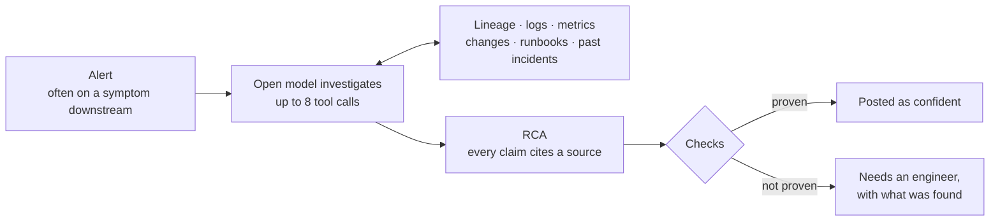

# Incident RCA agent

Starts from a monitoring alert on a data platform, finds the root cause across logs, metrics, recent changes,
runbooks and past incidents, and cites a source for every claim. When the evidence is not strong enough, it
says so and hands over to an engineer.

[](https://github.com/i-teamcollage/incident-rca-agent/actions/workflows/acceptance.yml)


> A working sample by [I-Team Collage](https://iteamcollage.com). It runs on a free, open model on a
> laptop and investigates made-up incidents. Nothing in this repository comes from a client.

## What it does

An alert tells you where a problem shows. It rarely tells you where it started. A dashboard goes stale
because a source three steps upstream hit an API limit an hour earlier.

This agent starts from the alert and works like an on-call engineer. It walks the lineage upstream, reads
the logs, compares metrics with their usual level, checks recent changes, and looks up the runbooks and
past incidents. It gets eight tool calls at most. Then it writes a root-cause analysis (RCA) in which every
claim cites the log line, metric or change it comes from.

The code then checks the RCA:

- every claim cites a source the agent really retrieved;
- the names and numbers in a claim appear in that source;
- the cause is the alerting pipeline or upstream of it;
- an error of that pipeline shows the failure, and a metric or a change backs it up.

When every check passes, the RCA is posted as confident. Otherwise it goes out as "needs an engineer",
with what was found and why it is not sure. Both come as a Slack-ready message.



## Results

The acceptance test was written before the agent was built. It runs on 25 made-up incidents the agent
was never tuned on.

<!-- results:start -->
Not measured yet.
<!-- results:end -->

The red herrings are the point of the test. In nine of the 25 incidents, something else looks guilty:

- a deploy on the alerting pipeline shortly before it went stale;
- a failure in another pipeline during the same hours;
- a metric that jumps on a pipeline that has nothing to do with the alert.

Full results, per incident and per failure type, are in [reports/acceptance.md](reports/acceptance.md).

## How this compares to the client build

The production version of this agent works for a data team running 200+ ETL pipelines. On the client's
own incidents it measured:

- 30 to 60 seconds to a full RCA summary, down from 30 to 45 minutes of manual triage;
- under 15 s p95 latency to a complete grounded answer;
- 0.78 accuracy against the labelled incident set;
- 0.80 grounding.

Those figures come from client data and cannot be reproduced here; the timings were measured on server
hardware. The numbers above are this sample's own, measured on a laptop.

A client build adds:

- triggering from your alerting (this sample starts from a stored alert);
- read access to your logs, metrics, runbooks and incident history, instead of exported files;
- posting to Slack, with follow-up questions (this sample writes the message to a file);
- your own labelled incidents as the acceptance set.

## Try it in a minute

No model and no packages are needed. The repository stores one real run, and replaying it re-runs all of
the agent's own code (tools, checks, scoring) against the model's recorded answers.

```bash
git clone https://github.com/i-teamcollage/incident-rca-agent
cd incident-rca-agent
make demo      # three incidents, explained
make accept    # the full acceptance test
```

You need Python 3.11 or newer, nothing else.

## Run it live

1. Install [Ollama](https://ollama.com), then pull the model: `ollama pull ministral-3:8b`. It is a 6 GB
   download, made by Mistral AI and licensed under Apache 2.0.
2. `make live` runs the acceptance test against the model. `make record` also stores the run.
3. Investigate one incident:
   `PYTHONPATH=src python -m incident_rca_agent run data/test/incidents/t-001`
   An incident is a folder with `alert.json`, `logs.txt`, `metrics.json` and `changes.json`. The RCA, the
   Slack message and a Markdown preview are written to `out/run/`.

## How it works

| File | What it does |
|---|---|
| [`tools.py`](src/incident_rca_agent/tools.py) | The seven tools: the alert, the lineage, log search, metric summaries, the change log, runbooks and past incidents. Every piece of evidence carries an id (`L-0142` for a log line, `M-1` for a metric summary, `CHG-4410` for a change), and the same call always returns the same text. |
| [`investigate.py`](src/incident_rca_agent/investigate.py) | The tool loop. The code reads the alert, then the model asks for up to seven more tool calls. |
| [`rca.py`](src/incident_rca_agent/rca.py) | One more model call writes the RCA from everything the tools returned. Its JSON schema only allows the ten failure types, real pipelines, and ids the investigation saw. An invalid answer gets one retry. |
| [`grounding.py`](src/incident_rca_agent/grounding.py) | The grounding check. A claim counts only when every id it cites was retrieved, and its pipeline names, numbers and times are in those sources. |
| [`confidence.py`](src/incident_rca_agent/confidence.py) | The confidence line: confident, or "needs an engineer" with the reasons. |
| [`slack.py`](src/incident_rca_agent/slack.py) | The Slack message (Block Kit JSON) and a Markdown preview. Nothing is sent. |
| [`tool_messages.py`](src/incident_rca_agent/tool_messages.py) | The only file that knows how tool calls are written for Ollama. |
| [`llm.py`](src/incident_rca_agent/llm.py) | Talks to Ollama with the standard library. Every call is fingerprinted, so a stored run replays exactly or stops with a clear message. |
| [`acceptance.py`](src/incident_rca_agent/acceptance.py) | Reads the thresholds in [`acceptance.toml`](acceptance.toml), prints PASS/FAIL with 95% intervals, and writes the reports and the table above. |

Design choices:

- **The model investigates. The code decides what is proven.** Confidence never comes from the model
  rating itself.
- **The error must show the failure.** The cited warning or error has to carry the signature the
  runbooks give for the failure type the model named, such as HTTP 429 for a rate limit or exit code 137
  for out of memory. A line in which a pipeline skips or waits for an upstream pipeline is a symptom: it
  points further up.
- **A deploy and a dropped row count are not enough.** A pipeline that waits for upstream data shows the
  same drop, so a log line is always one of the two kinds of evidence.
- **Same question, same answer.** Tool results are plain, repeatable text. Every call uses temperature 0
  and a fixed seed, and the stored run replays exactly on any machine.

## About the data

[`data/generate.py`](data/generate.py) writes the platform and every incident from fixed seeds and the
repository's own word lists, without Faker, so the data never changes unless the generator does.

- A data platform of 30 pipelines in six layers: sources, ingestion, staging, models, marts and exports.
  The lineage graph is in [`data/shared/lineage.json`](data/shared/lineage.json).
- 15 practice incidents and 25 test incidents. Tuning happens on the practice split only.
- Ten failure types, each in both splits: upstream schema change, API rate limit (HTTP 429), disk full,
  expired credentials, late upstream data, out of memory (exit 137), bad config deploy, duplicate keys,
  daylight-saving bug and DNS failure.
- Each incident has an alert, 200 to 500 log lines with routine warnings mixed in, hourly metrics for the
  incident window and the three days before, and a week of changes, most of them unrelated. Most alerts
  fire downstream of the cause.
- Red herrings in nine test incidents and five practice incidents.
- 15 runbooks with section ids, and 25 past post-mortems.

Every pipeline, host, team and incident is fictional, and any resemblance is a coincidence. Host names use
the reserved `.example` and `.internal` domains, so none of them points at a real service.

---

Built by [I-Team Collage](https://iteamcollage.com): workflow automation for finance, operations and
support teams in Europe, accepted only when it passes a test your own people wrote.
[Book a free 30-minute call](https://calendly.com/dorsa-maskouki/i-team-collage).

Licensed under the [MIT License](LICENSE).
